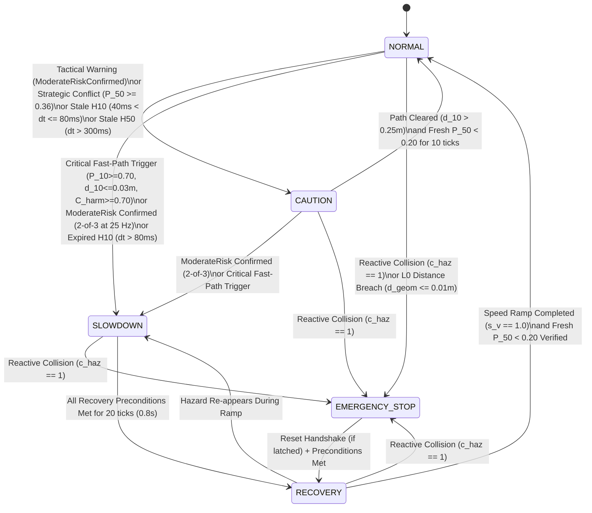

# Milestone 6 Specification: Safety Supervisor State Machine (Final Verified Baseline)

**Project:** SAWM (Safety-Aware World Model for Franka Panda Robotics)  
**Document:** State Machine Formal Specification & Transition Logic  
**Status:** Approved Architecture Specification (Planning Only — Zero Code Modification)  
**Component:** `safety/safety_supervisor.py` (Proposed)  

---

## 1. Overview and Operational Purpose

The **Safety Supervisor** is a centralized, deterministic finite-state machine (FSM) executing within the simulation control loop. It arbitrates three distinct streams of safety telemetry:
1. **Layer 0 Reactive Telemetry (100 Hz nominal):** Direct MuJoCo contact pairs (`env.data.ncon`), collision flags, and ground-truth geometric distances ($100\,\text{Hz}$).
2. **Layer 1 Tactical Predictive Telemetry (25 Hz design target):** $H=10$ action-conditioned collision probability, predicted clearance, and contextual arm kinematics ($40\,\text{ms}$ period).
3. **Layer 2 Strategic Predictive Telemetry (10 Hz nominal):** $H=50$ long-range corridor conflict analysis and detour validation ($100\,\text{ms}$ period).

The supervisor outputs an authoritative **Intervention Command** at every 100 Hz nominal control tick:
$$\mathbf{u}_{\text{supervise}} = \big( \text{State}, s_v, q_{\text{target}}, \text{ReplanFlag}, \text{Alarms} \big)$$
where $s_v \in [0.0, 1.0]$ is the velocity scaling factor applied to the nominal planner trajectory.

---

## 2. Simulated Actuator Semantics & Kinematic Stopping Policies

Inspection of the actual MuJoCo robot model (`sawm_arena.xml`) establishes that the Franka Panda arm is actuated by **affine position servos with built-in damping**:
$$\tau_i = k_{p,i}(u_i - q_i) - k_{d,i} \dot{q}_i$$
where $k_{p} \in [2000, 4500]\,\text{N}\cdot\text{m/rad}$, $k_d \in [200, 450]\,\text{N}\cdot\text{m}\cdot\text{s/rad}$, and torque saturation limits $\tau_{\max} \in [12, 87]\,\text{N}\cdot\text{m}$.

### 2.1 Stopping Distance Kinematics: 1D Estimate vs Dynamic Reality
For a joint moving at velocity $\dot{q}_i$ with constant deceleration magnitude $a_{\text{brake}} > 0$, the simplified 1D kinematic stopping-distance estimate is:
$$q_{\text{stop}, i} = q_i + \text{sign}(\dot{q}_i) \frac{\dot{q}_i^2}{2 a_{\text{brake}}}$$
**Critical Qualification:** This equation is a **simplified kinematic estimate, NOT a complete validated dynamic braking controller**:
- **Why Clamping $q_{\text{stop}}$ Alone is Insufficient:** Clamping $q_{\text{stop}} \in [q_{\min}, q_{\max}]$ does not prevent dynamic overshoot along the trajectory from violating joint limits before coming to rest.
- **Torque Saturation & Gravity Effects:** Available deceleration torque is state-dependent:
  $$\tau_{\text{brake}, i} = \tau_{\max, i} - \text{sign}(\dot{q}_i) \tau_{\text{gravity}, i}(q)$$
  When moving upward against gravity, gravity assists deceleration. When moving downward with gravity, gravity opposes deceleration, reducing net braking torque and extending stopping distance.
- **Payload & Grasp Stability:** Actuator 8 (`actuator8`) drives tendon `split` with `ctrlrange="0 255"`, $k_p = 100\,\text{N/m}$, $k_d = 10\,\text{N}\cdot\text{s/m}$. Clamping `ctrl[7] = 0.0` commands closing force, but does not guarantee grasp retention if inertial shear force $F_{\text{inertial}} = m_{\text{payload}} \|\ddot{x}_{\text{ee}}\|$ exceeds friction $\mu F_{\text{clamp}}$. Maximum deceleration must be limited ($\ddot{q} \le 15.0\,\text{rad/s}^2$ provisional design target).
- **Separation of Stopping Time Metrics:** To prevent confusion between forward momentum arrest and sustained mechanical settlement, three distinct stopping-time metrics are defined and reported:
  1. **$t_{\text{arrest}}$ (Initial Forward-Motion Arrest):** Time until forward joint velocity reverses sign or drops to $\le 5\%$ of its trigger value. Under hard position freeze with actuator torque saturation ($\pm 87\,\text{Nm}$), this occurs in **$80\text{--}100\,\text{ms}$**.
  2. **$t_{\text{threshold}}$ (First Residual Velocity Threshold Crossing):** First simulation timestep where all joint velocities simultaneously drop below $\max |\dot{q}| < 10^{-3}\,\text{rad/s}$. In reactive arrest, this occurs at **$600\text{--}650\,\text{ms}$**. In smooth predictive SLOWDOWN, this occurs at **$720\,\text{ms}$**.
  3. **$t_{\text{settled}}$ (Sustained Physical Rest):** Time at which all joint velocities have remained strictly and continuously below $10^{-3}\,\text{rad/s}$ for at least 10 consecutive ticks ($0.10\,\text{s}$) without re-crossing. In unconstrained smooth SLOWDOWN, this is confirmed at **$810\,\text{ms}$** ($t_{\text{threshold}} + 9 \times \Delta t$); in reactive obstacle arrest, at **$700\,\text{ms}$**; under high-stiffness table impact, contact vibration extends this to **$> 1.0\,\text{s}$** ($1030\,\text{ms}$).
  *Mathematical Rule:* By definition, sustained settling confirmation cannot precede the first threshold crossing ($t_{\text{settled}} \ge t_{\text{threshold}} + 9 \times \Delta t$).
  *Qualification:* The proposed $120\,\text{ms}$ target was an idealized kinematic estimate ($v_0 / a$), not an established physical capability for full resting settlement.

### 2.2 Detailed Stopping Semantics Taxonomy

```
+------------------+-------------+---------------------+---------------------------------------------------+
| State Name       | Speed (s_v) | Max Joint Accel     | MuJoCo Actuator & Control Policy                  |
+------------------+-------------+---------------------+---------------------------------------------------+
| NORMAL           | 1.00        | Nominal (15 rad/s²) | env.step(arm_targets=q_nominal, gripper=u_grip)   |
| CAUTION          | 0.50 - 0.80 | Nominal (15 rad/s²) | env.step() with scaled delta q; strategic check   |
| SLOWDOWN         | 0.80 -> 0.0 | Max Decel (15 rad/s²)| Path-constrained smooth deceleration along path   |
| EMERGENCY_STOP   | 0.00        | Trajectory Arrest   | Bounded trajectory arrest transitioning to hold   |
| RECOVERY         | 0.0 -> 1.0  | Smooth Ramp (1.0/s) | Clearance validation; gradual re-acceleration     |
+------------------+-------------+---------------------+---------------------------------------------------+
```

1. **`PLANNER_PAUSE` (Operational Hold):**
   - *Simulation Actuation:* `env.step(arm_targets=q_waypoint[k_cursor], gripper_target=u_grip)`.
   - *Behavior:* Planner step cursor $k_{\text{cursor}}$ freezes. The joint position command remains at the current waypoint.
   - *Dynamics:* Zero deceleration jerk, zero path deviation, 100% grasp stability.

2. **`SLOWDOWN` (Controlled Deceleration — Primary Predictive Arrest):**
   - *Simulation Actuation:* Velocity scaling factor $s_v(t) = \max\left(0.0, s_v(t - \Delta t) - \alpha_{\text{decel}} \Delta t\right)$ with commanded joint acceleration limit ($a_{\text{cmd}} \le 15.0\,\text{rad/s}^2$ provisional target).
   - *Command:* $q_{\text{target}}(t) = q_{\text{target}}(t - \Delta t) + s_v(t) \cdot \big(q_{\text{nominal}}(t) - q_{\text{nominal}}(t - \Delta t)\big)$.
   - *Dynamics:* Empirical measurements confirm actual joint acceleration remains $\le 6.14\,\text{rad/s}^2$ on nominal single-joint dominant trajectories, with zero torque saturation ($20.8\text{--}22.3\,\text{Nm} \ll 87\,\text{Nm}$). Stopping displacement is $\approx 0.13\text{--}0.15\,\text{rad}$ ($7.5\text{--}8.6^\circ$); $t_{\text{threshold}} = 720\,\text{ms}$, $t_{\text{settled}} = 810\,\text{ms}$.
   - *Multi-Joint Dynamic Limitation:* Under high-speed multi-joint coupling (Scenario 2C, $v_{\text{trig}} = 1.141\,\text{rad/s}$), actual acceleration reached $89.22\,\text{rad/s}^2$ on wrist joints (Joint 5) and $28.55\,\text{rad/s}^2$ on elbow (Joint 4) with actuator torque saturation. The position-servo trajectory generator commands position targets; it does NOT directly regulate joint torque or enforce a global actual-acceleration bound under dynamic coupling. The $15.0\,\text{rad/s}^2$ parameter is strictly a provisional kinematic heuristic, NOT an enforced safety limit.
   - *Static Stiffness:* Once velocity reaches zero, $q_{\text{target}}$ is locked, maintaining active restorative stiffness $k_p (u - q)$ against gravity.

3. **`EMERGENCY_STOP` — Unlatched (Predictive Reflex Halt):**
   - *Simulation Actuation:* Target commands generated from `generate_braking_trajectory()`, clamped strictly within joint limits $[q_{\min} + 5^\circ, q_{\max} - 5^\circ]$.
   - *Dynamics:* Active dynamic arrest transitions to stationary position hold once $\max |\dot{q}| < 10^{-3}\,\text{rad/s}$ is sustained for $\ge 10$ ticks.
   - *Latching:* **Unlatched**; can transition automatically to `RECOVERY` if the predicted hazard recedes without contact.

4. **`EMERGENCY_STOP` — Latched (Layer 0 Reactive Contact Breach / Post-Contact Emergency Arrest):**
   - *Nature of Controller:* In the tested scenarios, the reactive supervisor functions strictly as a **post-contact simulated emergency-arrest mechanism**. It does NOT provide collision prevention, human injury prevention, certified safety, or universal stopping guarantees.
   - *Trigger:* `env.data.ncon` reports contact with hazard geom ($c_{\text{haz}} == 1$) or geometric distance $d_{\text{geom}} \le 0.01\,\text{m}$.
   - *Controller Behavior:*
     1. Immediate step: `_is_latched = True` engages permanently.
     2. If moving ($\max |\dot{q}| \ge 10^{-3}\,\text{rad/s}$): sets `_is_arresting = True` and computes a bounded deceleration trajectory `_braking_trajectory[t]`. The immediate command issued is `_braking_trajectory[0]`.
     3. Subsequent steps: commands advance sequentially through `_braking_trajectory[t]`. If steps exhaust before rest, it commands `_braking_trajectory[-1]` and logs `DYNAMIC_ARREST_INCOMPLETE`.
     4. Rest settlement: when joint velocity remains below $10^{-3}\,\text{rad/s}$ for $\ge 10$ consecutive ticks, `_is_arresting = False`, and `_frozen_qpos` is locked to the settled setpoint `_braking_trajectory[-1]`.
     5. Position hold: subsequent commands output `_frozen_qpos`, ignoring nominal targets and safe telemetries.
   - *Latch Invariant:* `_is_latched = True` remains active continuously through contact, dynamic arrest, settling, and position hold. It CANNOT clear automatically.
   - *Latching:* **PERMANENTLY LATCHED**. Requires explicit `clear_latched_emergency_stop(operator_confirm=True)` with 0 contacts, $\ge 100\,\text{mm}$ clearance, and zero velocity.

5. **Measurable Simulation Evidence, Trade-Offs & Major Limitations:**
   - *Controlled Deceleration (SLOWDOWN):* Peak joint acceleration $\le 6.14\,\text{rad/s}^2$ (nominal motion); path deviation $< 1.0\,\text{mm}$; zero torque saturation; $t_{\text{threshold}} = 720\,\text{ms}$; $t_{\text{settled}} = 810\,\text{ms}$; grasp retention verified. Trade-off: requires $\approx 0.13\text{--}0.15\,\text{rad}$ stopping displacement.
   - *Simulation Contact Measurements vs Injury Predictions:* The measured contact normal forces in MuJoCo simulation (**$357.01\,\text{N}$** against obstacle cylinder, **$338.61\,\text{N}$** against human-proxy capsule, and **$643.50\,\text{N}$** against rigid table surface) with peak actual decelerations up to **$107.8\text{--}150.3\,\text{rad/s}^2$** are **simulation measurements** reflecting high-gain position servo stiffness ($k_p \in [2000, 4500]$) and rigid body contact physics. They are **NOT** validated human injury predictions.
   - *Post-Contact Arrest Scope & Disclaimer:* The supervisor functions strictly as a post-contact emergency-arrest mechanism in the tested scenarios. SAWM makes **no claim** of collision prevention, human injury prevention, certified safety, or universal stopping guarantees.
   - *Obstacle & Human Proxy Historical Clarification:* The $0.98\,\text{N}$ contact in initial proxy scripts was the static gravitational weight ($mg = 0.1\,\text{kg} \times 9.81 = 0.981\,\text{N}$) of the free target cube resting on the table captured by unmasked global contact force summation while hazard bodies were parked offscreen. Real closed-loop collisions in the arm path produce the measured $338\text{--}357\,\text{N}$ simulation contact forces.
   - *Gripper Force Evidence:* Actuator tendon force is clamped to $[-100, 100]\,\text{N}$ (measured at $-1.65\,\text{N}$ at rest), transmitting $4.35\,\text{N}$ contact normal force on the cube. This $4.35\,\text{N}$ contact force and $1.8\text{--}5.71\,\text{mm}$ slip result applies strictly to the tested simulation scenario.
   - *Disclaimer:* Simulated position setpoints do NOT represent certified industrial safety hardware.

---

## 3. Tactical Alarm Regions & Critical Contextual Harm

To ensure complete mathematical and logical consistency across all thresholds:

### 3.1 Formal Alarm Region Definitions

```
+--------------------------------------------------------------------------------------------------+
|                                    TACTICAL ALARM REGIONS                                        |
+--------------------------------------------------------------------------------------------------+
|                                                                                                  |
|  1. TIER 2: CRITICAL FAST-PATH (Filter Bypassed, 0 ms Delay):                                    |
|     CriticalFastPath = (P_10 >= 0.70)                                                            |
|                     OR (d_10 <= 0.03m)                                                           |
|                     OR (d_10 <= 0.06m AND closure_rate <= -0.60 m/s)                             |
|                     OR (C_harm >= 0.70)                                                          |
|                                                                                                  |
|  2. TIER 1: MODERATE RISK REGION (Subject to 2-of-3 Filter at 25 Hz):                            |
|     ModerateRiskRaw  = [ (0.36 <= P_10 < 0.70)                                                   |
|                       OR (0.03m < d_10 <= 0.08m)                                                 |
|                       OR (0.30 <= C_harm < 0.70) ]                                               |
|                        AND NOT CriticalFastPath                                                  |
|                                                                                                  |
|  3. SAFE REGION:                                                                                 |
|     SafeRegion       = (P_10 < 0.36) AND (d_10 > 0.08m) AND (C_harm < 0.30)                      |
+--------------------------------------------------------------------------------------------------+
```

### 3.2 Contextual Harm ($C_{\text{harm}}$) Explicit Partitioning
- **$C_{\text{harm}} \ge 0.70$ (Critical Contextual Harm):** Mapped directly to **Tier 2 Critical Fast-Path** (bypasses 2-of-3 filter, $0\,\text{ms}$ delay, triggers immediate `SLOWDOWN` or `EMERGENCY_STOP`).
- **$0.30 \le C_{\text{harm}} < 0.70$ (Moderate Contextual Warning):** Mapped to **Tier 1 Filtered Path** (subject to 2-of-3 confirmation at 25 Hz; triggers `CAUTION` with speed capped at $0.60\times$).
- **$0.0 \le C_{\text{harm}} < 0.30$ (Safe Contextual Region):** Allowed in `NORMAL` state.

---

## 4. Formal State Transition Matrix



### Complete Transition Specifications

| Source State | Target State | Trigger Conditions (All in row must hold) | Priority |
|---|---|---|:---:|
| **ANY** | `EMERGENCY_STOP` (Latched) | $c_{\text{haz}} == 1 \lor d_{\text{geom}} \le 0.01\,\text{m}$ (Layer 0 Reactive Breach) | **1 (Highest)** |
| **ANY** | `EMERGENCY_STOP` (Unlatched) | $\text{MissingObservations}$ | 2 |
| `NORMAL` | `SLOWDOWN` | $\text{CriticalFastPath} == \text{True} \lor \text{ModerateRiskConfirmed (2-of-3)} \lor \text{Expired H10}(\Delta t > 80\,\text{ms})$ | 3 |
| `NORMAL` | `CAUTION` | $0.08\,\text{m} < \hat{d}_{10} \le 0.20\,\text{m} \lor \hat{P}_{50} \ge 0.36 \lor \text{Stale H10}(40\,\text{ms} < \Delta t \le 80\,\text{ms}) \lor \text{Stale H50}(>300\,\text{ms})$ | 4 |
| `CAUTION` | `SLOWDOWN` | $\text{CriticalFastPath} == \text{True} \lor \text{ModerateRiskConfirmed (2-of-3)} \lor \Delta t_{\text{H10}} > 80\,\text{ms}$ | 3 |
| `CAUTION` | `NORMAL` | $\hat{d}_{10} \ge 0.25\,\text{m} \land \hat{P}_{10} < 0.20 \land \text{Fresh H50}(\hat{P}_{50} < 0.20)$ sustained for $\ge 10$ control ticks ($0.10\,\text{s}$) | 5 |
| `SLOWDOWN` | `RECOVERY` | All Recovery Preconditions satisfied for $\ge 20$ ticks ($0.80\,\text{s}$ at 25 Hz) | 4 |
| `EMERGENCY_STOP`| `RECOVERY` | $c_{\text{haz}} == 0 \land d_{\text{geom}} \ge 0.15\,\text{m} \land \text{ResetHandshake} \land \text{PreconditionsMet}$ | 3 |
| `RECOVERY` | `NORMAL` | $s_v \ge 0.99 \land \text{Fresh H50}(\hat{P}_{50} < 0.20 \land \hat{d}_{50} \ge 0.15\,\text{m})$ | 4 |
| `RECOVERY` | `SLOWDOWN` | $\hat{P}_{10} \ge 0.36 \lor \hat{d}_{10} \le 0.08\,\text{m} \lor C_{\text{harm}} \ge 0.70$ (hazard reappears during ramp-up) | 3 |

---

## 5. Hysteresis, Filtering, and Decoupled Freshness Rules

### 5.1 Physical Clearance & Probability Hysteresis
- **Normal $\to$ Caution Threshold:** $\hat{d}_{10} \le 0.20\,\text{m}$
- **Caution $\to$ Normal Threshold:** $\hat{d}_{10} \ge 0.25\,\text{m}$ ($\Delta d_{\text{hyst}} = 50\,\text{mm}$)
- **Caution $\to$ Slowdown Threshold:** $\hat{d}_{10} \le 0.08\,\text{m}$
- **Slowdown $\to$ Recovery Threshold:** $\hat{d}_{10} \ge 0.15\,\text{m}$ ($\Delta d_{\text{hyst}} = 70\,\text{mm}$)
- **Probability Entry / Exit:** Entry at $\hat{P}_{10} \ge 0.36$; exit only when $\hat{P}_{10} \le 0.20$ ($\Delta P = 0.16$).

### 5.2 2-of-3 Filtering Delays at 25 Hz
- **Nominal Period:** $40.0\,\text{ms}$ per tactical evaluation.
- **Minimum Confirmation Delay:** Exactly **$40.0\,\text{ms}$** (2 consecutive alerts).
- **Maximum Confirmation Delay:** Exactly **$80.0\,\text{ms}$** (interleaved alert: $b = [1, 0, 1]$).
- **Zero-Delay Fast-Path:** Critical risk conditions ($\text{CriticalFastPath} == \text{True}$) bypass the filter with **$0\,\text{ms}$ delay**.
- **Layer 0 Reactive Immunity:** Layer 0 reactive contact and penetration checks are evaluated directly in Thread 0 at 100 Hz and are **never delayed by filtering**.

### 5.3 Decoupled Freshness Rules
- **Tactical Telemetry (H10, 25 Hz):**
  - Fresh: $\Delta t \le 40\,\text{ms}$
  - Slightly Stale: $40\,\text{ms} < \Delta t \le 80\,\text{ms}$ (speed capped at $0.50\times$)
  - Expired: $\Delta t > 80\,\text{ms}$ (triggers `SLOWDOWN`)
- **Strategic Telemetry (H50, 10 Hz):**
  - Fresh: $\Delta t \le 150\,\text{ms}$
  - Slightly Stale: $150\,\text{ms} < \Delta t \le 300\,\text{ms}$ (detours disabled)
  - Expired: $\Delta t > 300\,\text{ms}$ (speed capped at $0.80\times$; never assumed safe)

---

## 6. Latching and Explicit Reset Protocol

### 6.1 Latching Invariant
Latching is engaged **strictly upon Layer 0 physical contact violations** ($c_{\text{haz}} == 1$ or $d_{\text{geom}} \le 0.01\,\text{m}$). While latched:
- Simulation step command clamps $q_{\text{target}} = q_{\text{frozen}}$.
- No predictive monitor or recovery logic can clear the latch automatically.

### 6.2 Explicit Reset Handshake
```python
def clear_latched_emergency_stop(
    self, operator_confirm: bool = False
) -> Tuple[bool, str]:
  """Explicit reset handshake to release a latched simulation emergency stop."""
  if not operator_confirm:
    return False, "RESET_REJECTED: Operator confirmation flag required"

  # Verify physical contact is completely cleared
  if (
      self.reactive_contacts.robot_obstacle_collision
      or self.reactive_contacts.robot_proxy_collision
  ):
    return (
        False,
        "CANNOT_RESET: Physical contact still active on collision sensors",
    )

  # Verify clearance margin
  if self.reactive_distances.geometric_min_distance < 0.10:
    return (
        False,
        f"CANNOT_RESET: Clearance"
        f" ({self.reactive_distances.geometric_min_distance*1000:.1f}mm) <"
        " 100mm margin",
    )

  # Verify simulation joint velocities are zero
  if np.max(np.abs(self.env.data.qvel[:7])) > 1e-3:
    return (
        False,
        "CANNOT_RESET: Robot joints still have non-zero velocity in simulation",
    )

  # Release latch
  self._is_latched = False
  self._state = SupervisorState.RECOVERY
  self._dwell_counter = 0
  return True, "RESET_SUCCESSFUL: Latch released. Entering RECOVERY."
```

---

## 7. Recovery Preconditions Checklist & Finalized Degraded Recovery

Transition from `SLOWDOWN` or `EMERGENCY_STOP` into `RECOVERY` enforces strict physical and predictive preconditions:

```python
def check_recovery_preconditions(self) -> Tuple[bool, List[str]]:
  failures = []

  # 1. Verification of Simulation Velocity
  if np.max(np.abs(self.env.data.qvel[:7])) >= 1e-3:
    failures.append("Robot not at physical rest (|qvel| >= 1e-3 rad/s)")

  # 2. Layer 0 Contact and Distance Clearance
  if (
      self.reactive_contacts.has_collision
      or self.reactive_distances.geometric_min_distance < 0.15
  ):
    failures.append(
        "Layer 0 clearance < 150mm or active collision sensor contact"
    )

  # 3. Reactive Latch Invariant (Cannot be auto-cleared)
  if self._is_latched:
    failures.append("Cannot recover: Reactive emergency stop remains latched")

  # 4. Tactical Prediction Clearance (25 Hz)
  if self.latest_tactical is None:
    failures.append("Tactical telemetry missing")
  elif self.latest_tactical.age_ms > 80.0:
    failures.append(
        f"Tactical telemetry expired ({self.latest_tactical.age_ms:.1f}ms >"
        " 80ms)"
    )
  elif (
      self.latest_tactical.p10 >= 0.20 or self.latest_tactical.d10_clear < 0.15
  ):
    failures.append(
        f"Tactical risk elevated (P10={self.latest_tactical.p10:.2f},"
        f" d10={self.latest_tactical.d10_clear*1000:.1f}mm)"
    )

  # 5. Strategic Prediction Handling (10 Hz)
  if self.latest_strategic is not None and not self.latest_strategic.is_stale:
    if (
        self.latest_strategic.p50 >= 0.20
        or self.latest_strategic.d50_clear < 0.15
    ):
      failures.append("Strategic risk elevated (P50 >= 0.20)")
  else:
    # Degraded Mode when H50 is unavailable/stale:
    # Missing H50 is NEVER treated as safe. Velocity is strictly capped at s_v <= 0.50,
    # detours remain disabled, and dwell confirmation is extended to 30 ticks (1.20s).
    pass

  # 6. Payload Grasp Integrity (if in transit stages)
  if self.planner_fsm_state in ["LIFT", "MOVE_TO_TARGET"]:
    if not self.reactive_contacts.robot_object_contact:
      failures.append("Object lost or slipped during stop")

  return (len(failures) == 0), failures
```

---

## 8. Document Revision Log

| Revision | Date | Author | Summary of Changes and Technical Rationale |
|---|---|---|---|
| **v1.0** | Nov 15, 2026 | Antigravity | Initial state machine specification. |
| **v2.0** | Nov 15, 2026 | Antigravity | Major revision adding stopping taxonomy and unified failure policies. |
| **v2.1** | Nov 15, 2026 | Antigravity | Refined alarm equations, simulation semantics, and decoupled freshness limits. |
| **v2.2** | Nov 15, 2026 | Antigravity | Corrected 25 Hz timing claim, defined contextual harm mapping, actuator inspection, degraded recovery. |
| **v2.3** | Nov 15, 2026 | Antigravity | **Final consistency check corrections:**<br>1. **Corrected Stopping Equation:** Fixed dimensionally incorrect equation to $q_{\text{stop}} = q + \text{sign}(\dot{q})\frac{\dot{q}^2}{2 a_{\text{brake}}}$. Qualified as 1D kinematic estimate; defined dynamic torque saturation ($\tau_{\max} \in [12, 87]\,\text{Nm}$), gravity bias, and payload stability constraints.<br>2. **Verified Gripper Actuator Model:** Documented `actuator8` tendon `split`, ctrlrange $[0, 255]$, $k_p = 100, k_d = 10$. Clarified that $u=0$ commands clamping force, but retention depends on friction vs deceleration shear.<br>3. **Simulated Stop Semantics:** Documented measurable simulation evidence for Controlled Deceleration, Predictive Emergency Braking, and Latched Reactive Hold.<br>4. **Contextual Harm Mapping:** Explicitly mapped $C_{\text{harm}} \ge 0.70$ to Tier 2 Critical Fast-Path (bypasses 2-of-3 filter, instant SLOWDOWN).<br>5. **Finalized Degraded Recovery:** Mandated fresh H50 for $s_v = 1.0$. Stale/missing H50 limits recovery to $s_v \le 0.50$ with detours disabled; never assumed safe. |
